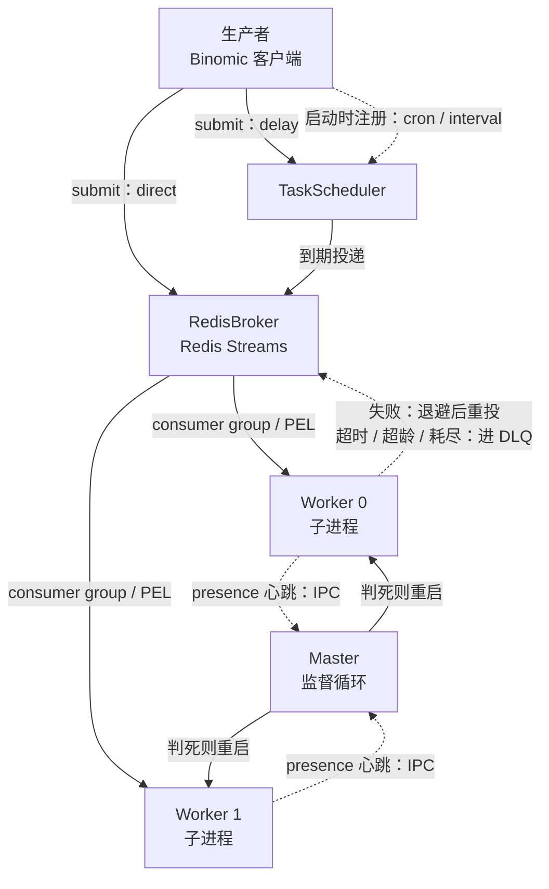

<div align="center">

# Binomic

基于 anyio 与 Redis Streams 的异步任务框架

[中文] **·** [English](README_en.md)

[](https://github.com/Ahsen17/binomic/actions/workflows/pytest.yml)
[](LICENSE)
[](pyproject.toml)

</div>

---

## 简介

Binomic 是一个自定义异步任务框架：以装饰器声明任务，以 Redis Streams 投递消息，
由多进程 Worker 消费执行，客户端进程内的 Master 监督循环负责监督与故障回收。消息体采用
[msgspec](https://jcristharif.com/msgspec/) JSON 序列化，任务 ID 使用 UUIDv7。

## 特性

- **声明式任务**：`@task()` 装饰器，支持 `direct`（立即）、`delay`（延迟）、
  `cron`（cron 表达式）、`interval`（固定间隔）四种模式
- **Redis Streams 消息代理**：基于消费者组与 PEL 的可靠投递，支持通过
  `xautoclaim` 回收失联消费者的消息
- **失败重试与死信队列**：失败的消息按退避（1.5 秒起、逐次翻倍、封顶 30 秒）在
  `max_attempts`（默认 3）之内重投；超时、超龄与耗尽次数的消息进入死信队列（DLQ），
  可检查、可重放，并支持 `on_dead` 死信通知钩子
- **多进程 Worker**：Master 以 multiprocessing 启动多个 Worker 子进程，并携
  presence 心跳持续监督
- **可观测性（可选）**：统一 structlog 日志；安装 `binomic[otel]` 后可产生
  跨进程关联的 traces 与执行耗时、投递滞留、队列深度等 metrics，由
  `BinomicConfig.otel_enabled` 开启，SDK 与导出归调用方，详见
  [可观测性指南](docs/guide/observability.md)
- **类型安全**：全量 mypy strict 与 ruff 检查，任务注册表基于泛型 `TaskSpec[P, T]`
- **Litestar 集成**：内置 `BinomicPlugin`，将 Binomic 客户端注入 Litestar 依赖

## 安装

```bash
# uv
uv add binomic

# pip
pip install binomic
```

要求 Python ≥ 3.12，Redis ≥ 7.x。

## 快速上手

### 1. 声明任务

在应用包内的 `tasks.py` 模块中用装饰器声明任务（Worker 通过
`autodiscover` 自动发现所有 `tasks.py` 模块）：

```python
# myapp/tasks.py
import time

from binomic.task import task


@task("default")
def example(index: int = 0) -> None:
    print(f"[{index}] Current time: {time.time()}")


@task("default", mode="delay", delay=10)  # 延迟 10 秒执行
def delayed() -> None: ...


@task("default", mode="cron", cron="*/5 * * * *")  # 每 5 分钟执行
def periodic() -> None: ...


@task("default", mode="interval", interval=30)  # 每 30 秒执行
def poll() -> None: ...
```

第一个位置参数是队列名（需与 `queues` 配置对应），任务以函数名原样注册（区分大小写）；
`cron` 与 `interval` 模式的函数不能带参数。任务还可以用 `on_dead=fn` 声明死信通知
钩子：消息因超时、超龄或耗尽 `max_attempts` 进入 DLQ 后，`fn(entry, reason, exc)`
会被调用一次（无返回值，钩子异常会被记录并吞掉），详见
[可靠性指南](docs/guide/reliability.md)。

### 2. 启动并投递

```python
from binomic.client import Binomic, BinomicConfig, BinomicFactory
from binomic.broker import Message

factory = BinomicFactory(
    broker_dsn="redis://localhost:6379/0",
    module_name="myapp",
    config=BinomicConfig(queues=["default"], workers=2, concurrency=5),
)

binomic: Binomic = factory.create()

# 进入上下文后启动 Master（拉起 worker 子进程）并提供提交入口；
# 构造时已自动发现 myapp 包内所有 tasks.py 模块并注册任务
async with binomic:
    await binomic.submit(Message(task="example", args=[1]))
```

消息进哪条 Stream 由任务声明里的队列决定（消息上不指定队列）；`enqueued_at` 由客户端进程内的
broker 在 enqueue 时盖戳（不是 `Message` 上的字段），无需手工赋值。`submit`
只支持 `direct` 与 `delay` 两种模式：`cron` 与 `interval` 任务在客户端启动时自动注册，
对其调用 `submit` 会抛 `ValueError`。Redis key 前缀与消费者组名（`namespace`）
由客户端在内部按 `module_name` 派生，Worker 侧同样派生，两侧自动落在同一命名空间；
它不是用户面参数。Worker 的调节旋钮同样是 `BinomicConfig` 字段：
`task_timeout` / `read_count` / `poll_interval` / `heartbeat_interval` /
`reclaim_interval`，语义见[可靠性指南](docs/guide/reliability.md)；可观测性开关
`otel_enabled` 与子进程初始化钩子 `worker_init` 同样是它的字段，见
[可观测性指南](docs/guide/observability.md)。

### 3. Litestar 应用中集成

```python
from binomic.client import BinomicConfig
from binomic.plugin.litestar import BinomicPlugin
from litestar import Litestar

app = Litestar(
    plugins=[
        BinomicPlugin(
            app_name="myapp",
            broker_dsn="redis://localhost:6379/0",
            config=BinomicConfig(queues=["default"]),
        )
    ],
)
```

处理器内通过 `binomic` 参数注入 `Binomic` 客户端。

## 架构



- **Producer**：`Binomic.submit` 经 `BrokerFactory` 按 broker DSN 协议创建代理并
  `enqueue` 消息；`delay` 任务交给调度器延后投递，`cron` 与 `interval` 任务不经
  `submit`，而在客户端启动时注册为周期作业。
- **Scheduler**：`TaskScheduler` 为 `delay` / `cron` / `interval` 三种模式创建对应的
  触发器，到期后走与 `direct` 相同的入队路径。每个 Worker 自己也持有一个
  `TaskScheduler`，承担失败重投的退避延时。
- **Broker**：`RedisBroker` 将消息写入 Redis Streams：每队列 `:stream`（条目只存
  消息 id）+ `:hash`（完整封套），开启遥测时另有 `:context`（trace 上下文，按消息 id
  存放，ack/dead 时清理）；DLQ 是 `:dlq:stream` + `:dlq:hash`。失联消费者的 PEL
  消息由 `reclaim`（`xautoclaim`）回收重投，重投时 `attempt + 1` 并重新盖戳；
  失败重投则保留原 `enqueued_at`——`task_timeout` 是投递总时限。
- **Master / Worker**：Master 监督循环运行在客户端进程内，以 multiprocessing 拉起
  Worker 子进程并监督其存活。
  心跳走**进程间 IPC**（每个 worker 一个共享 `multiprocessing.Value`，由 Master 创建、
  随子进程构造传入），不经 Redis —— 因此 `is_alive()` 之外还能识别「进程活着但已停跳」；
  Master 按 `heartbeat_interval` 的倍数轮询判死，命中即终止并重建同名 worker。
  Worker 在进程内通过 `anyio` 以配置并发执行任务。任务成功后 `ack`；失败则**退避后**
  在 `max_attempts` 之内重投，超时、超龄与耗尽次数的消息进死信队列（DLQ）；任务被取消
  时**不 ack**，消息留给 `reclaim`。

## 路线图

以下是当前已知缺口与迭代规划，按优先级排列，勾选即完成；已落地的能力以
[CHANGELOG.md](CHANGELOG.md) 为准。

- [x] **P0 · 进程监督 OTel 化** —— Master 监督面已接入 `binomic[otel]`：
  `binomic.worker.heartbeat.age` gauge 与 `binomic.worker.restarts` counter
  （带 `binomic.worker.reason` 属性）由客户端进程内的监督循环发射，告警与审计
  两用；正常停机不计入重启
- [ ] **P0 · 延时作业持久化** —— `delay` 模式的提交仍依赖客户端进程内存中的调度器，
  进程退出即丢；需要将延时作业落盘（Redis 侧排队）
- [x] **P0 · 存储有界** —— ack/dead/reclaim 对终态条目做 `XDEL` 清理；radix 树节点在
  整节点删空后即释放，主队列实为滑动窗口、不随历史增长（已实测验证）。DLQ 有意不自动
  清理（审计/重放面），保留策略如需再另行迭代
- [ ] **P1 · DLQ 运维工具链** —— 回放、检查与保留策略的标准化入口；数据面已备
  （DLQ 有意不自动清理），缺管理面
- [x] **P1 · 配置开放** —— `task_timeout` / `heartbeat_interval` /
  `reclaim_interval` / `read_count` / `poll_interval` 已提升为 `BinomicConfig` 字段，
  进 context 时映射进 `WorkerPolicy`
- [x] **P1 · 死信队列** —— 超时、超龄与超出 `max_attempts` 的消息进入 DLQ
  （`{namespace}:{queue}:dlq:stream` + `:dlq:hash`），可检查、可重放
- [ ] **P2 · Redis HA 兼容验证** —— Sentinel/Cluster 拓扑下六个 Lua 脚本与
  consumer group 语义的兼容性验证
- [ ] **P2 · 投递侧限流** —— 队列级速率/容量上限；消费侧背压已具备
- [ ] **P2 · 大规模稳定性验证** —— 多实例、Redis 抖动与网络分区下的长稳测试
- [x] **P2 · 多实例** —— consumer 名带 hostname + Master pid 前缀（同主机与跨主机
  实例均不撞名）+ reclaim 顺带清扫空 PEL 的死 consumer，支持同一 Redis 库上并存多个
  客户端实例
- [x] **P2 · 可观测性** —— 统一 structlog 日志（提交、执行、重试/DLQ、监督与
  生命周期）；可选 `binomic[otel]` 提供 traces 与 metrics：producer/consumer span
  跨进程关联，执行耗时、投递滞留、阶段计数、队列深度与在途任务等指标，由
  `BinomicConfig.otel_enabled` 开启。SDK 装配与导出归调用方；自定义 broker 不实现
  `BrokerTelemetryMixin` 时自动降级为 root span/无队列 gauge

## 开发

```bash
make install    # 初始化虚拟环境并安装依赖
make check      # lint + 类型检查 + 全部测试
make coverage   # 覆盖率报告（fail_under = 80）
make changelog  # 由 git-cliff 再生成 CHANGELOG.md
```

提交信息遵循 [Conventional Commits](https://www.conventionalcommits.org/zh-hans/)，
详见 [CONTRIBUTING.md](CONTRIBUTING.md)。

## 变更日志

[CHANGELOG.md](CHANGELOG.md) 由 [git-cliff](https://git-cliff.org) 从提交历史生成，
禁止手动编辑。

## 许可证

[MIT](LICENSE)
