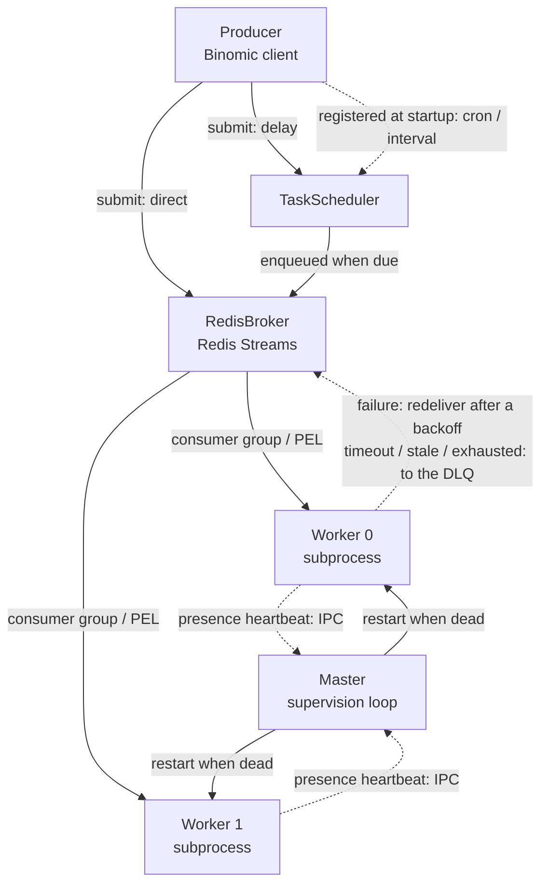

<div align="center">

# Binomic

A customized async task framework built on anyio and Redis Streams

[中文](README.md) **·** [English]

[](https://github.com/Ahsen17/binomic/actions/workflows/pytest.yml)
[](LICENSE)
[](pyproject.toml)

</div>

---

## Introduction

Binomic is a customized async task framework: tasks are declared with a
decorator, messages are delivered over Redis Streams, multiprocess workers
consume and execute them, and an in-process master supervision loop oversees
the fleet and reclaims work from dead consumers. Message payloads are serialized with
[msgspec](https://jcristharif.com/msgspec/) JSON, and task IDs use UUIDv7.

## Features

- **Declarative tasks**: the `@task()` decorator with `direct` (immediate),
  `delay` (deferred), `cron` (cron expression), and `interval` (fixed interval)
  modes
- **Redis Streams broker**: reliable delivery built on consumer groups and the
  PEL, with `xautoclaim`-based reclaim of messages from dead consumers
- **Retries and dead-letter queue**: failed messages are redelivered after a
  backoff (1.5 seconds, doubling, capped at 30) up to `max_attempts`
  (3 by default); timed-out, stale and exhausted messages land in a dead
  letter queue (DLQ) that can be inspected and replayed, and observed
  through an `on_dead` hook
- **Multiprocess workers**: the master spawns worker subprocesses via
  multiprocessing and supervises them with a presence heartbeat
- **Observability (optional)**: unified structlog logging, plus optional
  traces and metrics via `binomic[otel]` -- cross-process correlated spans and
  metrics such as execution duration, delivery lag and queue depth. Enable it
  with `BinomicConfig.otel_enabled`; the SDK and export stay with the
  application. See the [observability guide](docs/en/guide/observability.md)
- **Type safe**: fully mypy strict and ruff checked, with a generic
  `TaskSpec[P, T]` task registry
- **Litestar integration**: the built-in `BinomicPlugin` injects the Binomic
  client into Litestar dependencies

## Installation

```bash
# uv
uv add binomic

# pip
pip install binomic
```

Requires Python ≥ 3.12 and Redis ≥ 7.x.

## Quick start

### 1. Declare tasks

Declare tasks in a `tasks.py` module inside your application package (the
worker discovers every `tasks.py` module through `autodiscover`):

```python
# myapp/tasks.py
import time

from binomic.task import task


@task("default")
def example(index: int = 0) -> None:
    print(f"[{index}] Current time: {time.time()}")


@task("default", mode="delay", delay=10)  # runs after a 10-second delay
def delayed() -> None: ...


@task("default", mode="cron", cron="*/5 * * * *")  # runs every 5 minutes
def periodic() -> None: ...


@task("default", mode="interval", interval=30)  # runs every 30 seconds
def poll() -> None: ...
```

The first positional argument is the queue name (it must match the `queues`
configuration), and tasks are registered under the function name as written
(case-sensitive); functions in `cron` and `interval` mode take no arguments.
A task can also declare a dead-letter notification hook with `on_dead=fn`:
once its message enters the DLQ (timeout, staleness, or exhausted
`max_attempts`), `fn(entry, reason, exc)` is called once (no return value;
hook errors are logged and swallowed) — see the
[reliability guide](docs/en/guide/reliability.md).

### 2. Start and submit

```python
from binomic.client import Binomic, BinomicConfig, BinomicFactory
from binomic.broker import Message

factory = BinomicFactory(
    broker_dsn="redis://localhost:6379/0",
    module_name="myapp",
    config=BinomicConfig(queues=["default"], workers=2, concurrency=5),
)

binomic: Binomic = factory.create()

# Entering the context starts the master (spawning worker subprocesses)
# and exposes the submission entry point; construction has already
# discovered and registered every tasks.py module inside myapp
async with binomic:
    await binomic.submit(Message(task="example", args=[1]))
```

Which stream a message lands in is decided by the queue in the task
declaration (a message does not specify one), and `enqueued_at` is stamped by
the client-side broker at enqueue time (not onto the `Message`), so it needs no manual
assignment. `submit` supports
only the `direct` and `delay` modes: `cron` and `interval` tasks are registered
automatically when the client starts, and calling `submit` on them raises
`ValueError`. The worker tuning knobs are `BinomicConfig` fields too:
`task_timeout` / `read_count` / `poll_interval` / `heartbeat_interval` /
`reclaim_interval` — see the [reliability guide](docs/en/guide/reliability.md).
The telemetry switch `otel_enabled` and the subprocess hook `worker_init` are
`BinomicConfig` fields too; see the
[observability guide](docs/en/guide/observability.md). The Redis key prefix and consumer group name (`namespace`) are
derived internally from `module_name` by both the client and the workers, so
the two sides land on the same namespace automatically; it is not a
user-facing parameter.

### 3. Integrate with Litestar

```python
from binomic.client import BinomicConfig
from binomic.plugin.litestar import BinomicPlugin
from litestar import Litestar

app = Litestar(
    plugins=[
        BinomicPlugin(
            app_name="myapp",
            broker_dsn="redis://localhost:6379/0",
            config=BinomicConfig(queues=["default"]),
        )
    ],
)
```

Inside handlers, the `Binomic` client is injected through the `binomic`
parameter.

## Architecture



- **Producer**: `Binomic.submit` creates a broker via `BrokerFactory` based on
  the broker DSN scheme and enqueues the message; `delay` tasks are handed to
  the scheduler for a deferred enqueue, while `cron` and `interval` tasks do
  not go through `submit` and are registered as periodic jobs when the client
  starts.
- **Scheduler**: `TaskScheduler` creates the matching trigger for each of the
  `delay` / `cron` / `interval` modes and enqueues through the same path as
  `direct` once a job is due. Each worker holds one of its own too, carrying
  the backoff of a failed redelivery.
- **Broker**: `RedisBroker` writes messages to Redis Streams: per-queue
  `:stream` (entry ids only) + `:hash` (full envelopes), plus `:context`
  (trace context by message id, swept on ack/dead) when telemetry is enabled;
  the DLQ uses `:dlq:stream` + `:dlq:hash`. Workers read them through a consumer
  group, and messages stranded in a dead consumer's PEL are redelivered via
  `reclaim` (`xautoclaim`), which bumps `attempt` and stamps anew. Failure
  retries keep the original stamp — `task_timeout` is a total delivery
  deadline.
- **Master / Worker**: the master supervision loop runs inside the client
  process and spawns worker subprocesses through multiprocessing, supervising
  their liveness. The heartbeat goes over
  **inter-process IPC** (one shared `multiprocessing.Value` per worker, created
  by the master and handed to the child through its constructor) rather than
  through Redis -- so beyond `is_alive()` it can still recognise a process that
  is up but has stopped beating; the master polls at a multiple of
  `heartbeat_interval` and terminates and rebuilds a worker the moment it is
  judged dead. Each worker executes tasks concurrently within its process via
  `anyio`. A task that succeeds is `ack`ed; one that fails is redelivered
  **after a backoff** while `max_attempts` lasts — the copy and the ack of the
  original are one atomic Lua call; timed-out, stale and exhausted messages
  land in the dead letter queue (DLQ); a cancelled task is **not** `ack`ed,
  leaving its message to `reclaim`.

## Roadmap

The list below tracks the known gaps and the planned iteration order; a
checked box means done. For what has landed, see
[CHANGELOG.md](CHANGELOG.md).

- [ ] **P0 · Persisted delayed jobs** -- `delay`-mode submissions still depend
  on the scheduler living in the client process's memory and are lost on exit;
  they need to be persisted (queued on the Redis side)
- [x] **P0 · Bounded storage** -- ack/dead/reclaim `XDEL` terminal entries;
  radix-tree nodes are released once fully deleted, so live queues are a
  sliding window that does not grow with history (verified empirically). The
  DLQ is deliberately never auto-pruned (audit/replay surface); iterate on a
  retention policy only if it is ever needed
- [x] **P1 · Configuration** -- `task_timeout` / `heartbeat_interval` /
  `reclaim_interval` / `read_count` / `poll_interval` are now `BinomicConfig`
  fields, mapped into the `WorkerPolicy` on context entry
- [x] **P1 · Dead-letter queue** -- timed-out, stale and exhausted messages
  land in the DLQ (`{namespace}:{queue}:dlq:stream` + `:dlq:hash`), inspectable
  and replayable
- [x] **P2 · Multi-instance** -- consumer names carry hostname + master-pid
  prefixes, so instances never collide on the same host or across hosts, and
  reclaim sweeps away dead empty-PEL consumers, so several client instances can
  share one Redis database
- [x] **P2 · Observability** -- unified structlog logging (submission,
  execution, retry/DLQ, supervision and lifecycle) plus optional traces and
  metrics via `binomic[otel]`: producer/consumer spans correlated across
  processes, plus execution duration, delivery lag, phase counters, queue
  depth and in-flight tasks. `BinomicConfig.otel_enabled` turns it on; SDK
  assembly and export stay with the application. Custom brokers that skip
  `BrokerTelemetryMixin` degrade to root spans and no queue gauges

## Development

```bash
make install    # set up the virtual environment and install dependencies
make check      # lint + type check + full test suite
make coverage   # coverage report (fail_under = 80)
make changelog  # regenerate CHANGELOG.md with git-cliff
```

Commit messages follow [Conventional Commits](https://www.conventionalcommits.org/);
see [CONTRIBUTING_en.md](CONTRIBUTING_en.md) for details.

## Changelog

[CHANGELOG.md](CHANGELOG.md) is generated from the commit history by
[git-cliff](https://git-cliff.org) and must not be edited by hand.

## License

[MIT](LICENSE)
